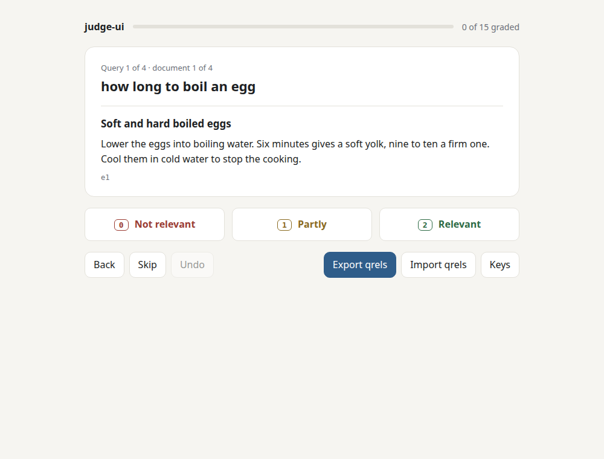

# judge-ui

Search quality is measured on judged queries, and judging is the slow part: someone reads each result and says
whether it answers the query. judge-ui makes that a keyboard job: 2 relevant, 1 partly, 0 not, next.

**Live:** [judge-ui.ahmed-abied.workers.dev/?sample](https://judge-ui.ahmed-abied.workers.dev/?sample) opens a small
sample pool. Everything runs in your browser; nothing is uploaded.



## Try it in under a minute

Open the live link above and press `2`, `1` or `0`. Or run it locally:

```sh
git clone https://github.com/Ahmedabied/judge-ui && cd judge-ui
npm ci && npm run dev        # then open the printed address and click "Try the sample"
```

## Keys

| key | does |
|---|---|
| `2` `1` `0` | grade relevant, partly, not relevant, and move to the next ungraded document |
| `→` or `s` | skip for now |
| `←` | back |
| `u` or Backspace | undo the last grade and return to it; a changed grade goes back to what it was |
| `e` | export qrels |
| `?` | show the keys |

Keys with Ctrl, Alt or Cmd are left alone, so browser shortcuts still work. A held key grades one document, not a
run of them: a keyboard repeats about 30 times a second, and nobody reads that fast.

## The files

**In: a pool**, one JSON object per line, one line per document to judge:

```json
{"query_id": "q1", "query": "how long to boil an egg", "doc_id": "e1", "title": "Soft and hard boiled eggs", "text": "Lower the eggs into..."}
```

Documents are grouped by query and shuffled with a seed taken from the query id, so the order is the same on every
load and does not show which search config ranked a document first. Bad lines and repeated documents are listed and
skipped, not fatal.

**Out: qrels**, the TSV that [relevance-gate](https://github.com/Ahmedabied/relevance-gate) and BEIR read:

```
query-id	corpus-id	score
q1	e1	2
```

The export is `grades.tsv` and holds what you graded in this pool, nothing else. A first round is your
`qrels/test.tsv` as it is. A later round is added to it, never saved over it:

```sh
relevance-gate judge --data mysearch --take grades.tsv
```

relevance-gate leaves judged documents out of the next pool, so the next export has only the new grades. Saved over
the qrels file, it would drop every earlier round. `--take` keeps them, lets a newer grade win and prints each one
it changed. A test here runs both programs through two rounds and checks that no grade is lost.

**Import qrels** loads an earlier export, or grades made with `relevance-gate judge` in the terminal, so you can
switch between the two. It says how many rows it left out because their documents are not in this pool.

**Two judges.** Give two people the same pool; each grades in their own browser and exports. Then
`relevance-gate agree sam.tsv alex.tsv --disagreements settle.tsv` reports how far they agree (Cohen's kappa,
weighted for graded relevance, with an interval) and lists the documents to talk through, biggest gaps first.

Progress is saved in the browser after every grade, keyed by a hash of the pool, so closing the tab loses nothing.
Reopen the same pool and it picks up where you stopped, and says how many grades it restored. If the browser blocks
storage (cookies off, some private windows), grading and export still work and a red line says progress is not
being saved. A grades-per-minute counter shows your pace (pauses over two minutes are not counted).

## Measured

| | |
|---|---|
| download, gzip | 74.3 KB (JavaScript 72.7, CSS 1.3, HTML 0.3), almost all of it React |
| build | 0.57 s |
| tests | 30, about 1 s (1 runs relevance-gate and is skipped without it) |
| one key press at the 100,000 document cap | 12 ms to write progress (0.2 ms at 2,000 documents); where you are in the pool is looked up, not counted again |

`npm run build && npm run size` prints the sizes.

## Security

Document text comes from your search index, so it is untrusted: React renders it as text, never as markup (there is a
test with `<script>` and `` in a pool). The live site sends a Content Security Policy with
`default-src 'none'`, scripts and styles from its own origin only, and `connect-src 'none'`: the page cannot send your
grades anywhere. Pool files are capped at 50 MB and 100,000 documents, and fields at 20,000 characters.

## Limits

- **One judge per browser.** There is no server, so no shared queue. Agreement between two judges is measured
  from their exports with `relevance-gate agree`. An export holds one judge's grades for one pool and nothing
  carried over, so shared rows cannot pad the agreement. Settled grades are merged by hand.
- **Pools over about 3 MB** are not kept for "Continue the last pool" (browser storage limits); grades still are.
  Drop the file again to continue.
- **No rich documents.** Text only; HTML in a document is shown as text.
- **No pace number for a real session yet.** The counter is there; a 50-query timing will be added once someone
  judges one.

## Related

- [relevance-gate](https://github.com/Ahmedabied/relevance-gate) makes the pool files (`judge --pool-out`), takes
  the exports back (`judge --take`), scores a search engine on the grades, and fails a pull request when search
  gets worse.
- [judge-bias](https://github.com/Ahmedabied/judge-bias) is about the other kind of judge: it measures whether an
  LLM judge favours its own model's answers, with human judgments as the yardstick.

## Development

```sh
npm ci
npm test            # Vitest, Testing Library, axe-core accessibility checks on both screens
                    # with relevance-gate 0.2.0 or later on the PATH, one more test runs the two together
npm run build && npm run size
```

Deployed as static assets on Cloudflare Workers (`wrangler deploy`, see `wrangler.jsonc`; headers in
`public/_headers`).

Built with AI pair programming.

## Licence

MIT
